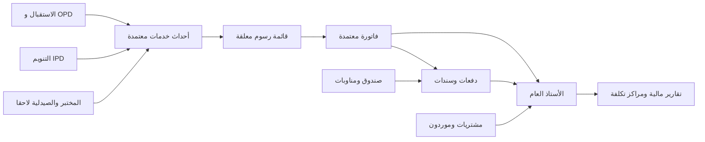

# ميزان الطبي — خارطة التنفيذ بعد توسيع المقارنة مع الأنظمة الطبية

**تاريخ:** 2026-11-16  
**الوضع الفعلي:** المشروع الحالي هيكل تجريبي 0.1.0؛ البنود في هذه الوثيقة **متطلبات مستقبلية** ما لم يرد خلاف ذلك نصا في الكود والاختبارات.

## A. الترتيب الإلزامي للأولويات

| الدفعة | النطاق | مخرجات دقيقة | معايير قبول أساسية |
|---|---|---|---|
| P0-A: سلامة الأساس | بيانات ومدفوعات وخادم مركزي | نقل EnsureCreated إلى migrations؛ دليل حسابات فعلي؛ حالات المستند (مسودة-معتمد-مرحّل-معكوس) | استعادة قاعدة موجودة دون فقد؛ القيود متوازنة؛ لا حذف مباشر لمستند مرحل |
| P0-B: استقبال OPD | مريض، طبيب، زيارة، خدمة، قائمة أسعار، قسيمة | حدث خدمة فريد ورقم زيارة، فاتورة متعددة البنود، خصم بإذن، طباعة إيصال | عدم تكرار الفاتورة عند إعادة الطلب؛ منع أسعار غير معتمدة؛ قابلية طباعة عربية |
| P0-C: التحصيل والخزينة | صناديق، مناوبات، قبض، صرف، استرداد، دفعات جزئية | توزيع المقبوضات على الفواتير، يومية لكل مناوبة، عد نقدي وفروقات | انقطاع الشبكة أو التزامن لا ينتج إيصالين؛ لا قبض فوق المستحق |
| P0-D: التقارير والإدارة | لوحة مالية، سجل تدقيق، مستخدمون، نسخ/استعادة | كشف فواتير/مقبوضات/ذمم، صلاحيات حسب الدور، استعادة اختبارية | مطابقة يومية وسجل محاسبي؛ منع وصول خارج الصلاحية من الـAPI |
| P1-A: التنويم IPD | غرف وأسرة ودخول/نقل/خروج | رسوم أيام الإقامة والخدمات، دفعات مقدمة، حساب نهائي | عدم مضاعفة أيام الإقامة أو رسوم الخدمة؛ تسوية الدفعات المقدمة |
| P1-B: المحاسبة الكاملة | أستاذ عام، مراكز تكلفة، قيد يومية، فترات | ميزان مراجعة، قائمة دخل، مركز مالي، إقفال فترة | توازن الأرصدة ورفض الترحيل إلى فترة مغلقة |
| P1-C: الموارد المالية | موردون، مشتريات، بنوك، رواتب وأتعاب أطباء | مديونيات موردين، تسويات بنكية، عقود نسب الأطباء | فصل موافقة الشراء عن الصرف ومطابقة الفواتير |
| P2-A: التأمين والجهات | عقود وتأمين وجهات خيرية | أهلية وتغطية وتفويض، مطالبات وقبول/رفض وتسوية | مستحق المريض مفصول عن الجهة؛ رفض المطالبة لا يُعتبر قبضاً |
| P2-B: الصيدلية والمخزون | أصناف، دفعات، تواريخ صلاحية، جرد | نظام مخزون FEFO وترابط التكلفة بالمستند | لا صرف منتهي الصلاحية؛ تتبع الاسترجاع والتكلفة |
| P2-C: التكامل والتحليل | مختبر وأشعة، API، BI | قائمة طلبات مالية مع IDs قابلة للتكامل وقياس تسرب الإيراد | لا وصول للمعلومات السريرية غير اللازمة للمحاسبة |

## B. قائمة الوظائف الكلية المقترحة

1. بيانات المستشفى والعملة الأساسية وسياسة التقريب وسنوات الحسابات.
2. مستخدمون متعددون وصلاحيات على مستوى العملية والمستشفى والقسم والصندوق.
3. ملف مالي للمريض ورقم تعريفي فريد ومنع ازدواج الملف.
4. دليل الأطباء والتخصصات والأقسام ومراكز التكلفة.
5. أسعار خدمات بنسخ وتاريخ بداية ونهاية وربط بمصدر الخدمة.
6. تسعير للطوارئ والكشف والتحاليل والأشعة والتنويم والعمليات والخدمات المركبة.
7. زيارات OPD وقسائم معاينة وفواتير؛ ملاحظات طبية مختصرة منفصلة ومحمية إن لزم.
8. قبول وتنقل وخروج IPD وجدول رسوم الإقامة.
9. فواتير مبدئية/معتمدة/مرحلة؛ إشعارات دائن وإلغاء بعكس محاسبي.
10. خصومات وإعفاءات وحدود قيمة/نسبة مع اعتماد من صلاحيات أعلى.
11. سندات قبض نقدا أو بنكيا، وتوزيع دفعة واحدة على عدة فواتير.
12. دفعات مقدمة وأرصدة دائنة للمريض دون اعتبارها إيرادا تلقائيا.
13. استرداد مبالغ ومقابلته مع سند قبض سابق وبسبب وصلاحية.
14. صندوق ومناوبة لكل أمين صندوق، مع مطابقة الفروقات وإقفال موثق.
15. مصروفات إدارية، مدفوعات موردين، وتسلسل موافقات.
16. دليل حسابات، قيود مزدوجة، الأستاذ وميزان المراجعة، إقفال وإعادة فتح بضوابط.
17. تقارير مراكز تكلفة لكل قسم وخدمة وطبيب حسب الصلاحيات.
18. جهات تأمين واتفاقيات وأسعار تعاقدية ومطالبات وذمم.
19. مشتريات ومخازن وصيدلية وجرد وحركات دفعات الصلاحية.
20. رواتب وأتعاب الأطباء والتزامات مستحقة (بعد تحديد سياسات التعاقد).
21. عملات متعددة YER/SAR/USD بسعر صرف مثبت للمستند، بعد اعتماد سياستها.
22. PDF/Excel/CSV مع حراسة Excel formula injection وطباعة حرارية وA4.
23. نسخ احتياطي مشفر وفحص استعادة ومراقبة الأخطاء والتعافي.
24. تتبع كل عملية ونسخة مستند ومستخدم وتاريخ وسبب تعديلات/رفض.
25. مؤشرات تسرب الإيرادات، ذمم مؤخرة، مقارنة التحصيل المتوقع والفعلي.
26. واجهة عربية RTL، ليلي/نهاري، بحث سريع وترشيح وترقيم صفحات للنتائج الكبيرة.

## C. مبادئ واجبة في بناء الخادم متعدد المستخدمين

- `Desktop WPF -> HTTPS LAN API -> PostgreSQL`، ممنوع اتصال أي جهاز موظف مباشرة بقاعدة البيانات.
- **موديل موحد للعمليات المالية**: `BillableEvent` (مصدر الخدمة) -> `Invoice / CreditNote` -> `Payment / Allocation` -> `JournalEntry / Lines`؛ معرف الحدث الفريد يمنع التكرار، والترحيل يحدث في معاملة واحدة.
- **الإيداع والتوزيع** منفصلان؛ لا يوصف دفع التأمين المتوقع بأنه دفع تم فعليا، ولا تُحسب الدفعة المقدمة كإيراد تلقائيا.
- **فصل سياسات أسعار الخدمات** عن القواعد الثابتة في الكود، وتاريخ نسخة السعر يثبت مع الفاتورة.
- **الصلاحيات والتدقيق في الخادم** قبل أي عملية ذات أثر مالي؛ إخفاء زر في العميل ليس حماية كافية.
- **التزامن والتعافي:** مفاتيح idempotency، transaction isolation، قفل/إصدار السجلات عند الحاجة، واستعلام نتيجة الطلب عند فقد استجابة الشبكة.
- **لا سلوك Offline متعدد الكتابة موعود في المرحلة الأولى**؛ الإنترنت غير مطلوب، لكن اتصال أجهزة LAN بالخادم مطلوب. عند انقطاع LAN توقف العمليات المالية مع حفظ طلب غير مرسل فقط إذا كان ذلك آمنا ومصمما.
- **مراجعة قانونية ومحـاسبية محلية:** عدم فرض ضرائب أو ترميزات تأمين تلقائيا قبل اعتمادها من المستشفى.
- **حفظ الخصوصية:** تقليل تخزين بيانات المريض الطبية إلى ما يلزم للتحصيل، وإزالة اسم المريض من السجلات التقنية إن لم يكن لازما.

## D. معايير اختبار جديدة مشتقة من المقارنة

| الرمز | الاختبار | شرط النجاح |
|---|---|---|
| REF-001 | خدمة OPD واحدة تصل إلى النظام مرتين بنفس المصدر | رسم واحد وفاتورة/قيد واحد فقط |
| REF-002 | فاتورة 5000 قبض منها 3000 | رصيد 2000، المقبوض 3000، إيراد 5000 دون ازدواج |
| REF-003 | شخصان يحاولان سداد آخر 2000 في اللحظة نفسها | قبول إحدى العمليتين ورفض الثانية وإرجاع الرصيد الصحيح |
| REF-004 | قسيمة خدمة أصبحت معلقة ثم أُلغيت قبل الأداء | لا قبض ولا قيد مالي لخدمة غير منفذة |
| REF-005 | سداد من جهة تأمين متوقع ثم رفض المطالبة | لا يُسجل قبض نقدي قبل حدوثه؛ الذمم واضحة وموزعة |
| REF-006 | نقل سرير مريض في اليوم نفسه | لا تكرار رسوم يوم الإقامة بدون سبب معتمد |
| REF-007 | فاتورة مرحلة تحتاج تصحيحا | قيد عكسي/إشعار مع السبب؛ لا تعديل السجل الأصلي |
| REF-008 | صندوقان وأمينان في مناوبتين | لا اختلاط المقبوضات أو الأرصدة أو إقفال مناوبة مستخدم آخر |
| REF-009 | دفع شبكة مكرر بعد انقطاع الاستجابة | نفس معرف العملية ونفس نتيجة السند، بلا قبض إضافي |
| REF-010 | اعتماد خصم بدون دور مخول | رفض الخادم حتى لو طلب العميل مباشرة |
| REF-011 | استيراد CSV يحتوي صيغة تبدأ = أو + أو - أو @ | تصدير محمي يمنع تنفيذ الصيغ في Excel |
| REF-012 | إقفال فترة محاسبية | منع القيود والتعديلات فيها وفق صلاحيات الإقفال |
| REF-013 | تقرير الدخل/الصندوق | مجموع البنود يطابق الوثائق والقيود دون حساب التحصيل كإيراد ثان |
| REF-014 | نسخة احتياطية من بيانات تجريبية واستعادتها | مجموع أرصدة كل حساب وعدد وثائقه مطابق |
| REF-015 | أربع حزم Windows وتكامل API | نجاح Windows Core + Windows Release + PostgreSQL Integration، ثم 4 مخرجات |
| REF-016 | مستخدم مالي يطلب تشخيصا طبيا عبر API | رفض وصول غير مصرح وتسجيل تدقيق مناسب |
| REF-017 | صرف مخزون دواء منتهي الصلاحية | رفض الصرف مع تفسير قابل للمراجعة (عند تفعيل P2) |
| REF-018 | فاتورة/قبض بعملتين مختلفتين | منع الجمع دون سعر صرف مثبت وتسجيل فرق تحويل (عند تفعيل العملات) |

## E. مخطط التكامل المنطقي

## F. استراتيجية GitHub

- لكل مرحلة فرع مستقل وPR؛ كتابة اختبارات xUnit لخلل السلوك قبل التغيير.
- Windows Core وWindows Release يبدآن بالتوازي، وداخل Release يتم Restore/Build/Test قبل Portable/Installer.
- اختبار PostgreSQL تكاملي إلزامي، ويستحسن إضافة اختبارات صلاحيات/تزامن ومضاهاة توثيقية لكل مرحلة.
- ينتج عن الإصدار أربع حزم Windows (x86 x64 × Portable Installer) بعد النجاح.
- لا دمج في `main` عند وجود أي فشل أو عدم التأكد من تشغيل الحزم. خادم المستشفى مستقل عن حزم العميل.
- يتطلب الدمج أيضا قواعد حماية branch على GitHub؛ وجود workflow وحده لا يفرض الحماية.

## G. شؤون تحتاج تخصيصا مع الإدارة قبل تشغيل بيانات فعلية

أقسام المستشفى، شجرة الحسابات، العملة الأساسية والتقريب وأسعار الصرف، طريقة الاعتراف بالإيراد، صلاحيات الخصم/الإلغاء، نماذج التأمين المحلية، رواتب الأطباء، بيانات الطباعة، مدة الاحتفاظ، سياسة النسخ والاستعادة، عدد الصناديق والمناوبات. كل هذه قرارات تنفيذية غير مفترضة.
